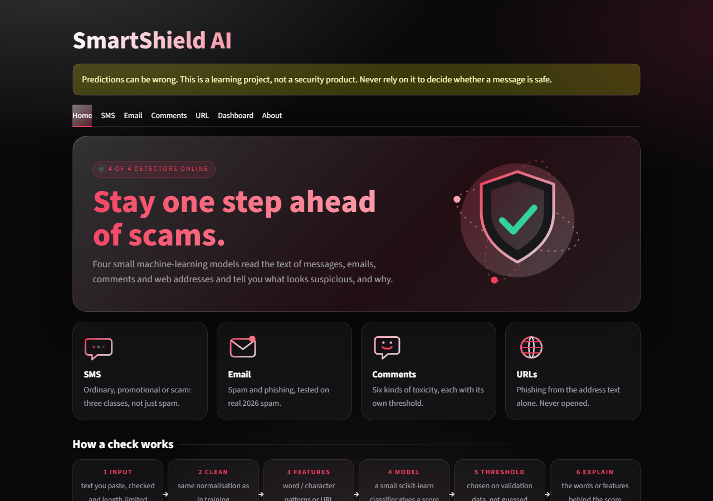
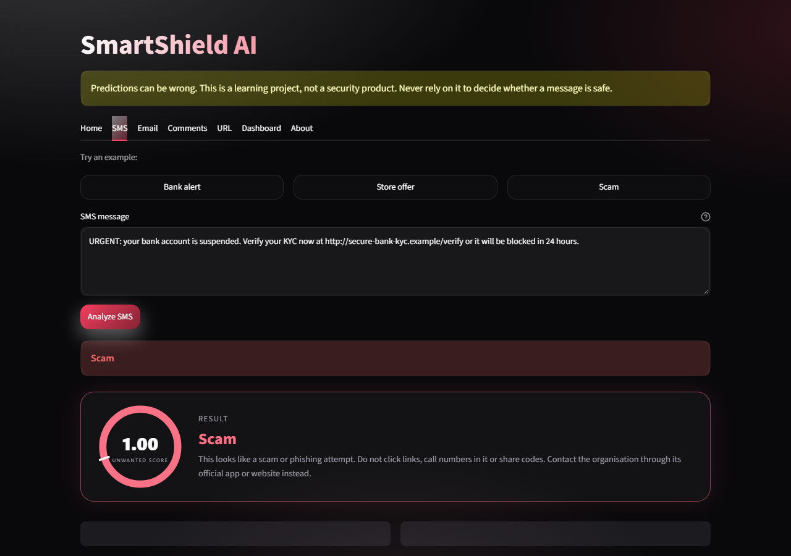
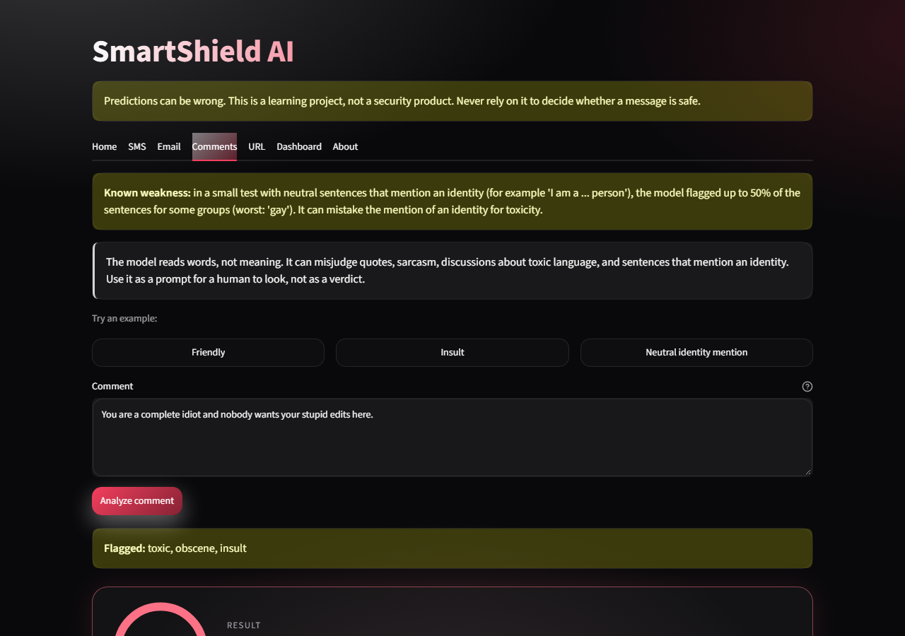
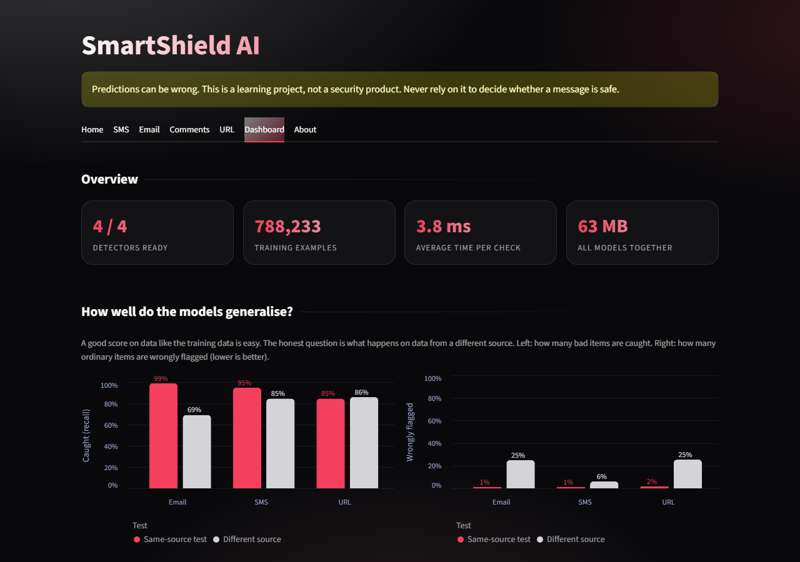
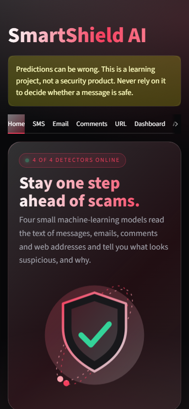

# SmartShield AI

Spam, phishing-URL and harmful-comment detection with traditional machine learning. A learning project that covers the full ML lifecycle: planning, data inspection, cleaning, deduplication, splitting, training, evaluation, an app, tests and deployment.

> **Status: Phases 0-12 complete, plus Phase 3b (three SMS categories).** All four detectors work end to end (data, models, detectors, Streamlit tabs, tests): **SMS** (Not spam / Promotional / Scam), **Email** (spam and phishing), **Comments** (six harmful-content labels) and **URL** (phishing). Each has documented weaknesses: the email model flags about a quarter of ordinary modern automated email (down from a third after adding a small modern dataset), the comment model flags some neutral sentences that mention an identity, and the URL model flags many legitimate pages on free hosting platforms. A real SBI bank alert that was wrongly flagged is now classified correctly after adding the owner's real messages (thin margin, see section 8). The app now has a Home page, a model-driven About page and the four detector tabs (Phase 8). Continuous integration (GitHub Actions) and a repository-hygiene check are in place (Phase 10). Phase 11 gave the app a new look (dark theme, animated illustrations, result rings, example buttons, a Dashboard) plus a one-command rebuild plan and a benchmark. Phase 12 added model cards (generated from the model files), dataset cards, a concepts page and the MIT LICENSE. Phase 13 (publishing and deployment) has written instructions in `docs/phases/phase-13-readme.md`; the project has not been pushed yet.
>
> **Warning:** predictions can be wrong and must never be relied on for real security decisions. This is a learning project, not a security product.

## Contents
1. [What works today](#1-what-works-today)
2. [Quick start](#2-quick-start-windows-powershell)
3. [Project structure](#3-project-structure)
4. [Architecture](#4-architecture)
5. [Datasets and their limits](#5-datasets-and-their-limits)
6. [Methodology](#6-methodology)
7. [Models and why they were chosen](#7-models-and-why-they-were-chosen)
8. [Results (SMS module)](#8-results-sms-module)
9. [Problems found along the way](#9-problems-found-along-the-way)
10. [The app and its safety design](#10-the-app-and-its-safety-design)
11. [Testing](#11-testing)
12. [Honest limitations](#12-honest-limitations)
13. [Roadmap](#13-roadmap)
14. [Key concepts](#14-key-concepts)
15. [Documentation index](#15-documentation-index)

---

## 1. What works today

| Phase | Done | Outcome |
|---|---|---|
| 0 | Requirements, risks, wireframes, decision log | `docs/` |
| 1 | Environment, pinned packages, Git, folder skeleton, linting | reproducible workspace |
| 2 | SMS data: download, inspect, clean, deduplicate, split, external set | 74,364 unique messages in train/val/test |
| 3 | SMS models: nine compared, one selected, evaluated, saved | `models/sms_spam/` |
| 4 | Detector module + Streamlit page + tests | `streamlit run app.py` |
| 5 | Email module: Enron-Spam + real 2026 spam test, safe parser, detector, Email tab | `models/email_spam/` |
| 6 | Harmful-comment module: Jigsaw, six labels, per-label thresholds, bias probe, Comments tab | `models/toxicity/` |
| 7 | Phishing-URL module: PhreshPhish + PhiUSIIL, URL-only features, temporal and cross-source tests, URL tab | `models/phishing/` |
| 8 | Full app: Home and About tabs, facts read from each model's `metadata.json`, per-tab error isolation | `app.py`, `src/detection/model_info.py` |
| 9 | Security and privacy: threat table, 44 security tests, Streamlit hardening, `pip-audit` clean, per-session rate limit, responsible-use text | `docs/security.md`, `tests/test_security.py` |
| 10 | Testing and CI: GitHub Actions (lint, tests on Linux and Windows, coverage gate 90%, weekly `pip-audit`), repo-hygiene check, Dependabot | `.github/`, `scripts/check_repo_hygiene.py` |
| 11 | New UI and Dashboard (themed, animated, no external assets), example buttons, `scripts/rebuild_all.py` (pipeline plan) and `scripts/benchmark_models.py` (speed/size table) | `src/ui/`, `scripts/`, `docs/phases/phase-11-readme.md` |
| 12 | Documentation: model cards (generated, tested against the model files), dataset cards, concepts page, LICENSE, link-checking test | `docs/model_cards/`, `docs/dataset_cards/`, `docs/concepts.md`, `LICENSE` |
| 9b | Follow-up on realised risks: modern email data added (false alarms 33% to 25%), comment-bias round 4 tried and rejected | `docs/phases/phase-09-readme.md` |

**389 automated tests pass (plus 3 expected failures and 1 unexpected pass that document known weaknesses); the linter is clean.**

## 2. Quick start (Windows PowerShell)

```powershell
git clone <your-repo-url> smartshield
cd smartshield
python -m venv .venv
.\.venv\Scripts\Activate.ps1
python -m pip install -r requirements-dev.txt
python -m pytest
streamlit run app.py
```

If PowerShell blocks activation: `Set-ExecutionPolicy -Scope CurrentUser RemoteSigned` (once).

Datasets and trained models are **not in Git**. To rebuild them, download the raw files into `data/raw/` (see [Datasets](#5-datasets-and-their-limits)), then:

```powershell
python -m scripts.prepare_sms        # clean, deduplicate, split, write the data-quality report
python -m src.training.train_sms     # main model: legitimate vs unwanted (about 15 minutes)
python -m src.training.train_sms_type  # second model: promotional vs scam (seconds; needs data/labels/)
python -m scripts.prepare_email      # email: clean, deduplicate, split, parse the 2026 spam safely
python -m src.training.train_email   # email model (about 20 minutes)
python -m scripts.prepare_toxicity   # comments: clean, deduplicate, split (about 10 minutes)
python -m src.training.train_toxicity --augment  # comments model (about 15 minutes)
python -m scripts.fetch_phreshphish_urls   # phishing: only URL columns of a 36 GB dataset (about 2 minutes)
python -m scripts.prepare_phishing   # phishing: clean, deduplicate, group-split, external sets (about 25 minutes)
python -m scripts.split_phiusiil     # phishing: split PhiUSIIL for training
python -m src.training.train_phishing --with-phiusiil  # phishing model (about 18 minutes)
python -m scripts.benchmark_models  # speed and size table
python -m scripts.make_model_cards  # regenerate docs/model_cards/ from the model files (a test fails if they go stale)
python -m scripts.evaluate_my_sms    # honest report on your private SMS (if data/private/my_sms exists)
python -m scripts.evaluate_my_email  # same for private emails (if data/private/my_email has rows)
python -m pytest
streamlit run app.py
```

Tested with Python 3.14 (see `docs/decisions.md`, D-011).



| Result with animated score ring | Comments (six scores) | Dashboard | Phone width |
|---|---|---|---|
|  |  |  |  |

## 3. Project structure

```text
app.py                      Streamlit app: Home, SMS, Email, Comments, URL, About (UI only)
.streamlit/config.toml      telemetry off, XSRF protection, errors hidden
config/settings.py          paths, seed, label convention (1 = bad)
src/
  data/                     loaders, deduplication, splitting, inspection, augmentation
  features/                 text normalization
  training/                 train_sms.py (compare, select, evaluate, save)
  evaluation/               metrics, threshold selection, plots
  models/                   toxicity_model.py (six-label model class)
  detection/                spam_detector.py, email_detector.py, toxicity_detector.py, phishing_detector.py, common.py,
                            model_info.py (About/Home facts), rate_limit.py (per-session throttle)
  ui/                       theme.py (CSS), components.py (escaped HTML/SVG blocks), dashboard.py (charts from metadata)
scripts/                    prepare_sms/email/toxicity/phishing.py (data + reports), fetch_phreshphish_urls.py, evaluate_my_*.py
models/sms_spam/            model.joblib (ignored by Git) + metadata.json
data/                       raw, processed, external_test, private (ignored by Git)
reports/                    data_quality/, metrics/ (CSV), figures/ (PNG)
tests/                      pytest tests + small hand-written challenge set
docs/                       requirements, risks, wireframes, decisions, phase READMEs
```

Rules the code follows: label convention **1 = bad, 0 = good**; training, inference and UI code are separate; the app never trains; nothing a user types is stored; every reported number comes from a real run.

## 4. Architecture

```text
raw datasets -> load -> inspect -> map labels -> deduplicate (within, then across)
   -> near-duplicate groups -> grouped stratified split -> leakage checks
   -> data/processed/sms/{train,val,test}.csv      data/external_test/sms/india_telecom.csv
                                   |
   fit vectorizer on TRAIN only -> tune on VALIDATION -> cross-validate on TRAIN
   -> select by pre-agreed rule -> choose threshold on VALIDATION
   -> evaluate ONCE on test + external + challenge set -> error analysis
                                   |
   models/sms_spam/model.joblib (+ SHA-256 in metadata.json)
                                   |
   load_sms_detector() [checksum] -> SpamDetector.predict() [validate, score, explain] -> app.py
```

## 5. Datasets and their limits

**No dataset in this project is from 2025-2026.** I searched; no public English SMS dataset with both spam and legitimate messages from that period was found. The newest usable material is about 2021-2024. SmishTank (real smishing, 2023-24) would help but needs a manual request at smishtank.com and has not been obtained.

| Dataset | Used for | Period | Notes |
|---|---|---|---|
| UCI SMS Spam Collection | train/val/test pool | ~2011 | 5,574 messages. UK spam vs Singapore student chat. CC BY 4.0 |
| Mendeley SMS Phishing Dataset | train/val/test pool | published 2022 | 5,971 messages. **84% re-uses UCI messages**. CC BY 4.0 |
| ScamShield `Smishing_Dataset` (Hugging Face, MIT card), English rows, synthetic rows excluded | train/val/test pool | claimed 2012-2024 | 69,070 messages, about 92% of the pool. Per-row origin unknown; licence chain of underlying sources not verified |
| ScamShield `Indian_Telecom_SMS` + benchmark rows | **external test only** | ~2021 | 2,049 messages. Different region and period; "spam" is mostly telecom promos |
| Template-written examples (`src/data/augment_sms.py`) | **training only** | n/a | 3,000 synthetic bank/transaction messages (1,500 legitimate, 1,500 scams); links use the reserved `.example` domain |
| Hand-written challenge set (`tests/data/sms_challenge.csv`) | evaluation smoke test | n/a | 33 messages (23 legitimate, 10 scams) |
| Owner's private SMS (`data/private/my_sms/`, ignored by Git) | train half (repeated) / held-out half | 2026 | 20 real messages; 13 legitimate, 7 promotional, none spam |
| **Email:** Enron-Spam (33,716 emails; repo licence GPL-3.0) | train / validation / test | ham 1999-2002, spam 2001-2005 | 30,138 unique after cleaning; dates give the class away (never a feature) |
| **Email:** untroubled.org spam archive, Jun-Oct 2026 | **external test, spam only** | 2026 | 10,228 unique emails; 73% hide filler text with CSS |
| Email hand-written challenge set (`tests/data/email_challenge.csv`) | guard / smoke test | n/a | 34 emails (24 legitimate modern, 10 spam) |
| **Comments:** Jigsaw Toxic Comment Classification (Hugging Face copy; labels CC0, text CC BY-SA 3.0) | train / validation / internal test, plus the official test set | Wikipedia talk pages, about 2017 | 159,272 unique comments after cleaning; official test 63,908 scored comments |
| Comments context probe (`tests/data/toxicity_probe.csv`) | smoke test | n/a | 36 hand-written sentences (24 benign, 12 mildly toxic), no slurs |
| **URLs:** PhreshPhish (CC BY 4.0, for anti-phishing research; URL columns only, read remotely) | train / validation / **newer temporal test** | Jul 2024 - Dec 2025 | 400,114 train, 82,682 val, 162,718 test |
| URLs: PhiUSIIL (UCI 967; labels flipped: 1 = legitimate there) | training (its homepage-only legitimate URLs balance PhreshPhish's deep pages) | ~2023 | 228,037 |
| URLs: CompPhish, PhishBench-External, OpenPhish feed (2026-10-12) | **external tests, never trained on** | 2024-2026 | 12,148 / 856 / 286 |
| URLs: hand-written (`tests/data/url_challenge.csv`) | guard / smoke test | n/a | 56 legitimate + 12 phishing-style (`.example` domains) |

Not used on purpose: ChatGPT-extended SMS set and ScamShield's synthetic rows (machine-generated test data would measure the generator, not spam), Hindi/Hinglish rows (a word-based model cannot use them).

Pooled statistics: 79,989 rows -> **74,364 unique** after removing within-dataset duplicates, 5,617 cross-dataset duplicates and 8 conflicting-label rows. Split: **52,048 train / 11,164 validation / 11,152 test**, spam share 38.1% in every split. The 38% spam share is far above a real inbox, so precision measured here overstates real-world precision.

Full details: `reports/data_quality/sms.md` (regenerated by the script) and `docs/phases/phase-02-readme.md`.

## 6. Methodology

- **Deduplicate before splitting**, at five levels: exact, normalized (case/spacing), conflicting labels (dropped), near-duplicate templates (kept but grouped), cross-dataset.
- **Split** with `StratifiedGroupKFold` (20 folds: 3 test, 3 validation, 14 train): the spam share is the same everywhere and near-duplicate templates never straddle splits. Leakage is checked by code (0 shared messages, 0 shared groups) and by tests.
- **Fit on training data only.** Vectorizers see training text only.
- **Rules fixed before looking at results:** compare by validation PR-AUC; if models are within 0.003, prefer the simpler/more explainable; choose the threshold with the highest validation recall at validation precision >= 0.98 (a false alarm hides a real message, so it is the worse error); look at test and external sets once, after choosing.
- **Cross-validation** (5 folds, grouped) on training data checks that differences between models are stable.
- **External validation** on a different-source set, plus a hand-written challenge set for a known blind spot.
- **Honesty about process:** the candidate set was extended after seeing Round 1 results (normalization, then augmentation). The selection rule was not changed, but the external set was therefore looked at in every round and its numbers are slightly optimistic. This is recorded in the decision log (D-015, D-018).

## 7. Models and why they were chosen

This is classification (the answer is a category), with a score that a threshold turns into a decision. Short text becomes sparse numeric features, which suits linear models. Candidates:

| Model | Idea | Result (validation PR-AUC) |
|---|---|---|
| Dummy | Always predicts the spam share | Floor: 0.381 |
| Multinomial Naive Bayes + word counts | Multiplies per-word evidence | 0.979, weakest real model |
| Logistic Regression + word TF-IDF | Weight per word | 0.992 |
| Linear SVM + word TF-IDF | Widest-margin boundary | 0.991 |
| **Logistic Regression + character n-gram TF-IDF** | Weight per 2-5 letter chunk | **0.995 (selected, with normalization)** |

Each ran raw and with artifact-removing normalization (`src/features/text_normalize.py`). Selected: `logreg_char_norm`, C = 10, threshold 0.6503, 5.2 MB, about 1.7 ms per message. More in `docs/phases/phase-00-readme.md` (how to choose classification vs regression and algorithms) and `phase-03-readme.md`.

## 8. Results (SMS module)

The app now shows one of three results: **Not spam**, **Promotional** (marketing from a business) or **Scam** (deception). Two models work in sequence:

- **Stage 1** (`models/sms_spam/`, Round 4): legitimate vs unwanted. Numbers from `reports/metrics/sms_final_metrics.csv`.
- **Stage 2** (`models/sms_type/`): promotional vs scam, trained on 380 hand-labelled messages.

**Stage 1 (current model, Round 5, threshold 0.700)**

| Set | Rows | Precision | Recall | False alarms | Missed |
|---|---|---|---|---|---|
| Validation | 11,164 | 0.980 | 0.955 | 82 | 193 |
| **Test (in-domain)** | 11,152 | **0.982** | **0.949** | 72 | 215 |
| **External (India telecom)** | 2,049 | 0.884 | 0.845 | 81 | 113 |
| Challenge set (hand-written, 33 messages) | 33 | 0.818 | 0.900 | 2 | 1 |
| **Owner's real messages, held-out half** | 13 | 10 right (was 8 before real data) | | 2 of 8 legitimate flagged (was 4) | |

**Stage 2 (promotional vs scam, small data)**: cross-validated accuracy 0.92 (scam precision 0.91, recall 0.85) on 380 messages; held-out hand-labelled test 0.96 on only 71 messages (19 scams), so treat the test number as noisy. Labels were written by the AI assistant, not verified by a human.

How the project's models changed over time:

| | Round 1 | Round 2 (+normalization) | Round 3 (+bank templates) | Round 4 (+more bank styles) |
|---|---|---|---|---|
| Test precision / recall | 0.981 / 0.954 | 0.983 / 0.953 | 0.984 / 0.951 | 0.982 / 0.948 |
| External precision / recall | 0.855 / 0.841 | 0.868 / 0.885 | 0.874 / 0.863 | 0.860 / 0.806 |
| Legitimate challenge messages flagged | 18 of 23 | 18 of 23 | 4 of 23 | 3 of 23 |

Real messages reported by the project owner (tested with the current models):

| Message | Result | Verdict |
|---|---|---|
| Taco Bell "FLAT 50% OFF ... pay via District by Zomato" | **Promotional** (scam likelihood 0.03) | Correct |
| SBI debit alert "A/C ... debited by 320.00 ... trf to ... If not u? call-1800111109 ... -SBI" | **Not spam** (score 0.63, threshold 0.70) | Correct now, thin margin; it was flagged before real private messages were added |
| "Rs :300/- is credited to your account" | Not spam | Correct |
| "Rs 300 credited to your account. Click http://claim-now.example to withdraw your bonus" | unwanted | Correct (a scam) |

Real-world precision will be lower than the table because real inboxes contain far less spam than the 38% in the training data. Round 4 was kept although it was not clearly better than Round 3 (decision D-020); Round 5 added the owner's real messages (decision D-021) and improved both the held-out messages and the external set.

### Email module results

Model: Logistic Regression on word and bigram TF-IDF with 120 data-source words masked (`logreg_word_masked`, threshold 0.443). Numbers from `reports/metrics/email_*.csv`.

| Check | Result |
|---|---|
| Enron-era test (4,521 emails) | precision **0.986**, recall **0.991** (30 false alarms, 20 missed) |
| **Real 2026 spam** (10,228 emails, spam only) | **69%** detected (June 65%, July 75%, August 71%, September 74%, October 93%) |
| 24 hand-written **modern legitimate** emails | **6 flagged (25%)** (was 8, 33%, before the synthetic modern emails were added to training) |
| Guard rule (at most 25% flagged) | **failed for every candidate**; the app shows a standing warning |

Why the high test score is misleading: ham is Enron staff email (1999-2002) and spam is later and from other sources, so the model can score 0.999 by recognising "Enron-style mail". Removing the source words lowered false alarms on modern email (42% to 33%) and also lowered 2026 detection (83% to 77%). The legitimate emails it wrongly flags are automated ones (statements, verification codes, receipts, newsletters), because the training data has almost none of them. Details: `docs/phases/phase-05-readme.md`.

### Comment (harmful content) module results

Model: word + character TF-IDF with one Logistic Regression per label (`logreg_wordchar`, C = 2), each label with its own threshold, trained with 3,750 neutral identity sentences (bias mitigation). 36.8 MB, about 10 ms per comment. Details: `docs/phases/phase-06-readme.md`.

| Label | Internal test F1 | Official test F1 | Official test positives |
|---|---|---|---|
| toxic | 0.80 | 0.66 | 6,085 |
| severe_toxic | 0.49 | 0.36 | 367 |
| obscene | 0.82 | 0.69 | 3,687 |
| threat | 0.56 | 0.50 | 211 |
| insult | 0.72 | 0.65 | 3,423 |
| identity_hate | 0.47 | 0.56 | 712 |
| **Macro-F1** | **0.642** | **0.569** | |

- Per-label thresholds matter: with the default 0.5, internal macro-F1 is 0.518 and `threat` F1 is 0.23 (it finds 14% of threats); with its own threshold, `threat` F1 is 0.56.
- ROC-AUC is 0.96-0.99 for every label while PR-AUC for the rare labels is only 0.32-0.49: ROC-AUC flatters imbalanced data.
- **Bias test (fails):** neutral sentences such as "I am a {identity} person." are flagged for some identities. Over three mitigation rounds the identity terms over the 5% limit fell from 12 to 3 and "gay" from 83% to 50% flagged, with no loss of accuracy, but the rule is still failed; the app shows a warning and the model must only queue comments for human review.
- **Context:** 5 of 24 benign sentences are flagged (mentions of toxic words and negation, for example "You are not an idiot"); 9 of 12 mildly toxic sentences are caught.

### URL (phishing) module results

Model: Logistic Regression on character n-grams of `host/path` (`logreg_char`, C = 4, threshold 0.644, 11.5 MB, about 3 ms per URL), trained on PhreshPhish + PhiUSIIL. The model reads only the address text: no page, certificate, domain age or blocklist. The query string, `www.` and http/https are ignored. Details: `docs/phases/phase-07-readme.md`.

| Set | URLs | Precision | Recall | Legitimate flagged |
|---|---|---|---|---|
| Validation | 114,650 | 0.970 | 0.741 | 2.0% (the fixed budget) |
| **Temporal test (Sep-Dec 2025, newer than all training data)** | 162,718 | **0.974** | **0.846** | **1.8%** |
| Test, domain groups unseen in training | 75,680 | 0.975 | 0.805 | 3.8% |
| CompPhish (external) | 12,148 | 0.755 | 0.860 | 25.4% |
| PhishBench-External (external) | 856 | 0.852 | 0.875 | 15.6% |
| OpenPhish live feed 2026-10-12 (phishing only) | 286 | n/a | 80.4% detected | n/a |
| Legitimate pages on free hosting platforms (test) | 108 | n/a | n/a | **55.6%** flagged |

The data taught the main lesson: **every public phishing dataset has a structural shortcut, in different directions.** PhiUSIIL's legitimate URLs are all bare `https://www` homepages (one rule scores 99.68%); PhreshPhish's legitimate URLs are deep pages with no query string. A model trained on one flagged 76-89% of the other's legitimate homepages. Four rounds (mixed sources; `www.` ignored; https ignored) are tabulated in the Phase 7 README. A later health check found that validation shared domains with training (37.9% of rows) and that external tests overlapped training; both were fixed and validation recall dropped from an inflated 0.839 to 0.741. Safety: URLs are text only, never opened or shown as links; shortened links get "Cannot judge"; the answer is never "safe".

## 9. Problems found along the way

| Problem | How it was found | What we did |
|---|---|---|
| No 2025-2026 data exists publicly | Search; SmishTank has no public file link | Stated plainly; external set from a different source and region |
| Mendeley is mostly a copy of UCI (84%) | Measured overlap | Pooled and deduplicated; not treated as independent |
| Inconsistent labels (`Smishing`/`smishing`), unreliable `URL` column, lost `£` characters | Inspection | Lowercase labels; ignore the column; documented |
| Dataset artifacts became shortcuts (HTML codes only in ham; `XX` masks 98% spam; chat words 99% ham) | Reading top model weights | Normalization (Round 2) |
| **Legitimate bank alerts flagged as spam** ("Rs 300 credited..."): 18 of 23 | **Reported by the project owner**, confirmed with a hand-written challenge set | Balanced template augmentation (Round 3): 18 -> 4 of 23 |
| **Genuine Taco Bell offer shown as "Spam"** | **Reported by the project owner** | Definition problem: the data calls marketing spam. Added a Promotional category (Phase 3b) |
| Dataset sub-category labels unreliable (phishing tagged "telemarketing", promos tagged "UPI fraud") | Reading samples | Did not use them; hand-labelled 500 messages for a second model |
| **Genuine SBI debit alert flagged; genuine SBI/YONO/OTP messages called scams** | **Reported by the project owner** | Cause: all 831 SBI and 314 YONO messages in the public data are phishing. Fix: the owner's real messages (hash-split, Phase 3b section 14): held-out right 8 -> 10 of 13 |
| **Email: 2026 spam hides a harmless filler paragraph with CSS** (73% of emails) | Samples showed friendly filler under phishing subjects | Parser drops CSS-hidden text; measured 2026 detection rose from 32% to 77%. **My first measurement was wrong, not the model** |
| Email: perfect scores (PR-AUC 0.999) from source words and dates | Reading class statistics before training | Dates never a feature; source words masked; hand-written modern set + guard |
| Email: modern legitimate automated mail flagged as spam (33%) | Hand-written challenge set | Reported in the app; private-email pipeline ready for real examples |
| **Comments: truncated download** (27.7 of 44.1 MB) | Parquet footer missing on load | Re-downloaded with retries; exact byte size verified |
| **Comments: test split is two stacked blocks** (text-only and label-only rows) and uses -1 for unscored rows | Row and column counts did not add up | Joined by id; only 63,978 scored rows used |
| **Comments: identity words treated as toxic** ("gay" flagged in 83% of neutral sentences) | Bias probe with unseen templates and identity words | 3 rounds of counterfactual augmentation: 12 to 3 terms over the limit, "gay" 50%; still failing, warning in the app |
| Comments: ROC-AUC 0.99 while rare-label PR-AUC is 0.3-0.5 | Per-label metrics | Judge rare labels by precision, recall and PR-AUC |
| **URLs: one-line rule scores 99.68% on PhiUSIIL** (all legitimate URLs are bare `https://www` homepages) | Per-class shape table before training | PhiUSIIL used only as one training source among others; held-out external sets |
| **URLs: opposite shortcut in PhreshPhish** (no benign query strings; deep paths; no hosting platforms) | Same table | Query ignored; mixed sources; hosting limitation documented |
| **URLs: `www.` and `https` shortcuts** (PhishBench homepages 99.8% flagged; `dell.com` = 0.99 phishing) | Cross-source test; typing real input into the app | Both removed from the features (Rounds 3-4) |
| **URLs: train/validation shared domains across two sources (37.9% of validation rows), and external tests overlapped PhiUSIIL training (9.3% / 5.9% of legitimate URLs)** | A health check that compared the final data files | Single consistent split; externals filtered against all training data; the training script now fails on any overlap |
| **Saved URL model could not be loaded by another program** (`__main__` pickling) | A test that loads each model in a fresh interpreter | Helper moved to an importable module; test covers all 5 models |
| Label noise in public data (`SAMSON`, `2.00E+12` labelled spam) | Reading errors | Documented; ceiling on achievable accuracy |
| My own report double-counted overlapping rows | Re-reading the generated report | Fixed; tested |
| In-domain test cannot reveal subgroup failures | Challenge set | Add a hand-written set for each important kind of legitimate message |
| Style and region bias remain (`bhk`, `haha`, `lol` carry weight) | Top-weight words | Documented; needs more diverse data |

The lesson in one line: **a high overall score is not evidence the model is right for every kind of message.**

## 10. The app and its safety design

`streamlit run app.py` shows an SMS box, an **Analyze** button, the result (Spam / Not spam), the model score, an explanation of which words pushed the score up, a "predictions can be wrong" warning, and an "About this model" panel whose numbers are read from `metadata.json`.

- **Detector separate from UI:** `src/detection/spam_detector.py` has no Streamlit code and is fully testable.
- **Input checks:** empty, blank, non-text and over-1,000-character input are rejected with a clear message. Nothing typed is stored or logged.
- **Missing model:** a clear instruction instead of a crash.
- **Checksum:** `joblib` files can run code when loaded, so the model is loaded only if its SHA-256 matches the value recorded at training time.
- **Loaded once:** `st.cache_resource` (Streamlit reruns the script on every click).
- **Explanation:** occlusion (remove each word, see how the score drops). Works for any model but is approximate; a message with several signals may show little.
- **Score wording:** "model score", not "probability of spam in your inbox".

### Phase 11: the new interface
- **Look (Crimson Noir):** near-black pages with crimson, silver and rose accents, set in `.streamlit/config.toml` and `src/ui/theme.py` (colours come from one palette, so another theme is one more entry in `PALETTES`). A gradient hero with an animated shield, glass cards, animated score rings, result cards, chips for the words behind a score, and threshold ticks on the score bars. `prefers-reduced-motion` switches the animation off.
- **Try an example:** each detector has three one-click samples (including a neutral identity sentence that shows the known bias, and a look-alike login URL).
- **Dashboard:** KPIs, generalisation charts (same-source test vs a different source, for recall and for false alarms), per-label comment metrics, data sizes, speed and size from the benchmark, the known weaknesses as measured numbers, this session's tally (counts only), and the training charts. Every number comes from `metadata.json` or the benchmark file.
- **No external requests:** no web fonts, no CDN, no images from the internet; illustrations are SVG documents embedded as data URIs (Streamlit strips inline `<svg>`, and an `` SVG cannot run scripts).
- **Speed:** the Dashboard is drawn only while its tab is open (`st.tabs(..., on_change="rerun")`), so clicks elsewhere stay fast.
- **Reproducibility:** `python -m scripts.rebuild_all` prints the whole pipeline in order with time estimates and missing inputs (`--run` executes it); `python -m scripts.benchmark_models` measures load time, median and slowest-5% latency, and size into `reports/metrics/performance.csv`.

### Phase 8-9 additions
- **Six tabs:** Home (what it does, how it works, privacy, which detectors are ready), SMS, Email, Comments, URL, About (every model's algorithm, training size, result and limitations, read from `metadata.json`; a Responsible use section).
- **Failure isolation:** a missing or corrupt model shows 'not available' for that detector only.
- **Security controls** (details and residual risks in `docs/security.md`): URLs are never fetched or linked; no raw HTML; no logging, printing or storage of input (checked by an AST test); Streamlit telemetry off and XSRF protection on; pinned dependencies audited with `pip-audit`; SHA-256 check before loading any model; a sliding-window limit of 30 analyses per minute per session (slows scripts, does not stop a determined attacker; real protection needs the host).

## 11. Testing

389 tests, all on synthetic or hand-written data except one group that uses the real SMS model and skips itself if it has not been trained:

| Area | Examples |
|---|---|
| Text keys, label mapping, deduplication, splitting, leakage | conflicting labels dropped; groups never split; same seed, same split |
| Metrics and threshold selection | confusion counts; target precision reached or reported as unreachable; model-selection tie rule |
| Normalization and augmentation | idempotent; both classes share currency vocabulary; no challenge text in augmentation; links use `.example` only |
| Detector | empty/None/too long rejected; missing, tampered and broken model refused; deterministic; explanation behaviour |
| App (Streamlit `AppTest`) | spam flagged, normal accepted, errors shown, warning always present, missing-model message |
| Email | input rules; pasted HTML reduced to visible text; CSS-hidden text dropped, ordinary styled text kept; attachments counted but never read; garbage bytes survive; tampered model refused; weakness warning shown only when the guard failed |
| Toxicity | six scores in order; labels flagged independently and can overlap; each label has its own threshold; explanation words; empty, over-long and non-text input rejected; tampered or missing model refused; Comments tab shows all six bars; bias warning only when the probe failed; the augmentation uses different templates from the probe |
| URLs | one shared feature function (the sklearn wrapper equals it exactly); `www`, query and scheme ignored; unsafe schemes, spaces, control characters and over-long input rejected; no network access while predicting; URL shown as plain text, never a link; never says "safe"; shortened links get "Cannot judge"; weakness warning only when the guard failed |
| Home, About, summaries | pages render with all models and with none; About numbers follow `metadata.json` |
| Security | no network/process imports or print/logging in serving code; no raw HTML; hostile text and dangerous URLs never crash; config, `.gitignore`, pinned requirements and secrets scan |
| Rate limit | sliding window with a fake clock; the app shows 'Too many requests' |
| Portability | all five real models load in a fresh Python process |
| Private data loaders | SMS and email: deterministic hash split, new data never moves old, duplicates and header-only files handled |
| Real-model regression | simple credit/debit alerts are not spam; the same alert plus a claim link is spam; challenge-set false alarms stay at or below 6 of 23 |

```powershell
python -m pytest
python -m pytest --cov --cov-report=term-missing   # coverage of the serving code
python -m ruff check . ; python -m ruff format --check .
python -m scripts.check_repo_hygiene                  # nothing forbidden is about to be committed
```

**CI** (`.github/workflows/ci.yml`) runs on every push and pull request: lint and format check, the hygiene check, the tests on Ubuntu and Windows with a 90% coverage gate, and `pip-audit` (also weekly). Model binaries and datasets are not in Git, so the 47 tests that need them skip themselves in CI (272 run and pass there; the other tests build tiny synthetic models). Coverage is measured on the app and everything that serves predictions (94%); offline training and plotting scripts are excluded because they are verified by running the pipeline and the health checks, not by unit tests.

## 12. Honest limitations

- No data from 2025-2026; results describe data up to about 2021-2024.
- Pooled spam share (38%) is unrealistic; real precision will be lower.
- About 92% of the pool is one source of unknown origin with label noise.
- Region/style bias remains in the model.
- The augmentation is synthetic (my templates); real bank alerts vary more. The challenge set is small and written by me.
- Genuine bank messages are handled only as well as the 7 real training messages allow (held-out: 10 of 13 right, 1 genuine SBI notice still labelled Scam). More private messages are needed.
- Conversational scams ("Mum, I lost my phone") and OTP-sharing scams are largely missed.
- The promotional-vs-scam model rests on 451 labels from one AI labeller (not human-verified); its test set has 19 scams.
- The external set was seen in every training round.
- **Email:** trained on 1999-2005 mail; flags about a quarter of ordinary modern automated emails; misses reward-point lures that use look-alike characters ("1OO", "pIan"); English only; reads the first 6,000 characters; no modern legitimate email data yet.
- **Comments:** trained on Wikipedia talk pages from about 2017; rare labels are weak (severe_toxic F1 0.36-0.49, threat 0.50-0.56); the official test is harder (macro-F1 0.57 vs 0.64); the model reads words, not meaning (negation, quotes); neutral sentences mentioning some identities are still flagged; English only. It must never be used to act on a person automatically. A fourth mitigation round (25 extra short-form neutral sentences per identity term) changed nothing: 'gay' is still flagged in 50% of neutral sentences, so it was rejected and the earlier model kept.
- **URLs:** reads only the address text. Flags 25% of CompPhish's legitimate URLs (small sites), 16% of PhishBench's, and about half of legitimate pages on free hosting platforms; catches 80-88% of external phishing; no page content, certificate or reputation data; shortened links cannot be judged; trained on 2024-25 data and phishing changes quickly.

## 13. Roadmap

Phases 5-12 (done) -> Phase 13 deployment -> Phase 11 performance -> Phase 12 final docs and model cards -> Phase 13 deployment -> maintenance and drift checks.

## 14. Key concepts

| Term | Meaning, with an example from this project |
|---|---|
| **Dataset** | Labeled examples: the 74,364 SMS messages with spam/ham labels |
| **Algorithm** | A learning recipe: Logistic Regression |
| **Feature extractor** | Turns text into numbers: character n-gram TF-IDF (fitted on training text only) |
| **Trained model** | The algorithm after learning from the data: the fitted classifier with its weights |
| **Inference pipeline** | Everything applied to new input: normalize -> vectorize -> classify -> threshold. Saved as one file (`model.joblib`) |
| **Threshold** | The score above which we say "spam" (0.6503), chosen on validation data |
| **External test** | Data from a different source, never used for training or tuning |
| **Shortcut learning** | The model uses an accident of the data ("Rs" = spam) instead of the real signal |

## 15. Documentation index

| File | Content |
|---|---|
| `docs/requirements.md` | What the app must do and how success is measured |
| `docs/risks.md` | 24 risks with mitigations and status |
| `docs/wireframes.md` | Page sketches |
| `docs/decisions.md` | Decision log D-001 to D-046 |
| `docs/phases/phase-00-readme.md` | Task types, how to choose classification vs regression, how to choose algorithms |
| `docs/phases/phase-01-readme.md` | Environment, pinning, Git |
| `docs/phases/phase-02-readme.md` | Data handling: inspection, five levels of duplicates, splitting |
| `docs/phases/phase-03-readme.md` | Training, evaluation, three rounds, difficulties |
| `docs/phases/phase-03b-readme.md` | Three categories, why the dataset's sub-labels were not used, the open SBI problem |
| `docs/phases/phase-04-readme.md` | Detector, app, checksum, tests |
| `docs/phases/phase-05-readme.md` | Email module: data, hidden-text spam, results, failures |
| `docs/phases/phase-06-readme.md` | Harmful-comment module: multi-label models, thresholds, bias probe, ethics |
| `docs/phases/phase-07-readme.md` | Phishing-URL module: shortcuts in the data, four rounds, safety rules |
| `docs/phases/phase-08-readme.md` | Home/About pages, single source of truth for numbers |
| `docs/phases/phase-09-readme.md` | Security hardening, rate limit, and the follow-up on realised risks |
| `docs/security.md` | Threat table, controls, residual risks |
| `docs/concepts.md` | Every ML idea used here, explained with an example from this project |
| `docs/model_cards/` | One card per detector: intended use, data, results, limits, ethics (generated) |
| `docs/dataset_cards/` | One card per data source family: source, licence, size, biases, risks |
| `LICENSE` | MIT for the code; datasets keep their own licences |
| `docs/phases/phase-13-readme.md` | Step-by-step: commit and push to GitHub, first CI run, recovering from mistakes, and the plan for deploying the app |
| `docs/phases/phase-12-readme.md` | Documentation phase: what each document is for and why |
| `docs/phases/phase-11-readme.md` | New UI, dashboard, sanitiser lessons, reproducibility and benchmark |
| `docs/phases/phase-10-readme.md` | Testing strategy, CI workflow, coverage, what CI cannot test |
| `reports/data_quality/phishing.md` | Generated phishing-URL data report |
| `reports/data_quality/toxicity.md` | Generated comment-data report (counts only) |
| `reports/data_quality/email.md` | Generated email data-quality report |
| `docs/sms_type_labeling_guide.md` | Rules used to label promotional vs scam |
| `reports/data_quality/sms.md` | Generated data-quality report |
| `reports/metrics/`, `reports/figures/` | Generated tables and charts (rounds 1 and 2 archived) |

## Licenses and credits

Datasets keep their own licences (UCI SMS Spam Collection, CC BY 4.0; Mendeley SMS Phishing Dataset, CC BY 4.0; ScamShield dataset on Hugging Face, MIT per its card, with underlying source licences unverified). Please cite the original authors if you reuse them. The code and documentation are MIT licensed (`LICENSE`, copyright held by the project owner; change it before publishing if you prefer another licence). Datasets are not redistributed and keep their own licences: see `docs/dataset_cards/README.md` for the full table, the provenance gaps, and a warning that models trained on share-alike data (Jigsaw text, CC BY-SA) may carry obligations. Each detector has a model card in `docs/model_cards/`.
